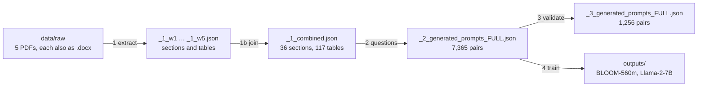

# Spanish financial chatbot: training data from bank PDFs

**[En español](README_ES.md)**

Five documents from a Spanish bank (Caja de Ingenieros: international transfer fees, a fund's
fact sheet, the loan catalogue and two notes on the CI Environment ISR fund, 43 pages in all)
become **question/answer pairs in Spanish**, and two language models, BLOOM-560m and Llama-2-7B,
are fine-tuned on them. The goal was a chatbot that answers questions such as *"¿Qué requisitos
hay que cumplir para solicitar un préstamo postgrado?"*. The repository stops at the training
scripts: it has no chat interface and no trained model.

<p align="center">
  
</p>

## The pipeline



| Step | Script in `pipeline/` | What it does | Runs? |
|---|---|---|---|
| 1 | `1_extract_all.py`, `1_extract_w1_fees.py`, `1_extract_w3_catalogue.py` | reads the `.docx` with python-docx: text sections and tables to JSON | yes, CPU |
| 1b | `1b_join.py` | joins the five per-document files into `_1_combined.json` | yes |
| 2 | `2_questions_sections.py`, `2_questions_tables.py` | questions from templates, spaCy entities and Spanish question-generation models | **no**, see [known issues](#known-issues) |
| 3 | `3_validate.py` | scores each pair by shared keywords and text similarity | yes, about 2 min on CPU |
| 4 | `4_train_bloom.py`, `4_train_llama2.py` | fine-tunes on the step 2 pairs | needs a GPU; checked on CPU with a tiny BLOOM |

The step 2 output, and what step 3 thinks of it:

<p align="center">
  
</p>

Two pairs from the dataset, one from a text section and one from a table:

```text
P: Para las transferencias no STP, ¿ qué tipo de comisión requiere una comisión adicional?
R: Para transferencias No STP (“Straight Through Processing”) se percibe una comisión adicional
   de 15€ por falta de BIC/IBAN o por datos incorrectos. Debe informarse al ordenante.

P: ¿Qué detalles están asociados con la ubicación para el elemento 'Target – 2' en la tabla
   'transferencias extrangero TRANSFERENCIAS EMITIDAS'?
R: EUR: EUR | ----: ---- | Nacionales/Internacionales dentro de la UE (…): Nacionales (OMF-España)
   Urgentes mismo día | … | 0 €: 2,5‰ Mín. 10€ Máx. 100€
```

The second answer pairs every value with a value of the SEPA row instead of a column name: that
is the missing header in the image above. [docs/method.md](docs/method.md) is the original
write-up of each step ([en español](docs/method_es.md)).

## Run it

Tested with Python 3.11:

```bash
pip install -r requirements.txt && pip install -e .     # -e makes finchat/ importable from pipeline/
python pipeline/1_extract_all.py                         # seconds; data/processed/extracted_word_data.json
python pipeline/3_validate.py                            # ~2 min; rewrites data/processed/_3_*.json
python pipeline/4_train_bloom.py                         # GPU; models and logs go to outputs/
python tools/check_imports.py                            # what CI runs
```

The scripts run from any folder: `finchat/paths.py` finds `data/` and `outputs/` from the
repository root. Run on the current `_2_generated_prompts_FULL.json`, step 3 keeps 1,274 pairs
and finds 25 valid, not the 1,256 and 20 of the committed files: those were made before the 20
hand-written pairs were added.

## Layout

```
pipeline/         the steps, in order: 1_extract_*, 1b_join, 2_questions_*, 3_validate, 4_train_*
finchat/          what the steps share: paths.py, questions.py (question templates and models),
                  validation.py (does an answer match its question)
data/raw/         the five documents: each PDF and the .docx made from it with iLovePDF
data/processed/   the dataset: the JSON of steps 1 to 3, as in the chart above
docs/             method.md and method_es.md (the original write-up), img/
tools/            check_imports.py (CI), make_readme_figures.py (these images)
legacy/           a helper module nothing imports and two superseded JSON files
outputs/          models, checkpoints and logs from step 4 (not in git)
```

## Known issues

- **Step 2 cannot run.** It imports `generate_questions_by_Model` from
  `finchat/google_generate_ask.py`, a module that was never committed.
- **The dataset cannot be rebuilt from the scripts.** The inputs of the join, `_1_w1.json` to
  `_1_w5.json`, were edited after step 1: for W3, step 1 finds 65 sections and 38 tables and
  `_1_w3.json` has 6 and 91; W2, W4 and W5 hold more than step 1 extracts. `_1_combined.json`
  was edited too (the join gives 119 tables, the file has 117). Treat `data/processed/` as the
  source.
- **W1's fee tables lose their column names** in step 1, so their answers read like the second
  example above.
- **Training uses the unfiltered pairs.** Both step 4 scripts read the step 2 output; nothing
  reads step 3's.
- **The labels do not teach the model to answer.** Both models are causal (decoder-only), but
  the scripts give the question as input and the answer's tokens as labels, position by
  position, padding included. For a causal model the input should be question and answer in
  one sequence, with the labels masked (-100) over the question and the padding.
- **The evaluation questions are in the training data.** The first 20 pairs of
  `_2_generated_prompts_FULL.json` are hand-written answers to the 10 questions
  `4_train_bloom.py` asks at its checkpoints, and BLOOM is evaluated on its own training set.
- **Llama-2-7B is fully fine-tuned** in fp16. That needs well over 100 GB of GPU memory; LoRA
  or QLoRA (the `peft` library) fits one GPU. The model is gated: accept Meta's licence on
  Hugging Face first.
- The documents are Caja de Ingenieros' own. Check that they may be republished here.

For five documents whose fees and rates change, retrieval (search the extracted sections and
tables, then let an instruction-tuned model answer from what it found, quoting the source)
would likely serve better than fine-tuning, and needs no retraining when a document changes.

## What changed in this reorganisation

- Scripts moved to `pipeline/` with names in run order, shared code to the `finchat/` package,
  documents and JSON to `data/`, the old READMEs to `docs/`, unused files to `legacy/`. Every
  move is a `git mv`, so `git log --follow` still shows each file's history.
- Paths no longer depend on the folder you run from.
- `requirements.txt` asked for `docx==0.2.4` (a different, Python 2 package; the code needs
  `python-docx`) and `transformers==4.18.0`, older than Llama 2. It now lists what the code
  imports, the spaCy Spanish model included.
- Step 4: `evaluation_strategy` (removed from current transformers) is now `eval_strategy`;
  `4_train_bloom.py` called `trainer.train()` twice, so it trained 6 epochs, not 3; the Llama
  model id is now `meta-llama/Llama-2-7b-hf`, the one Transformers can load.
- A CI check that every `finchat` import resolves.
