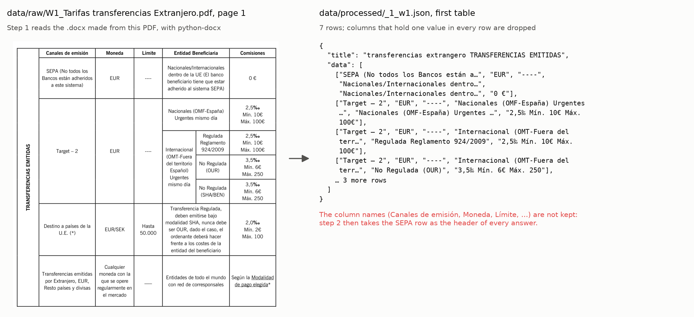
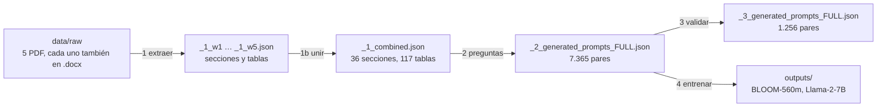
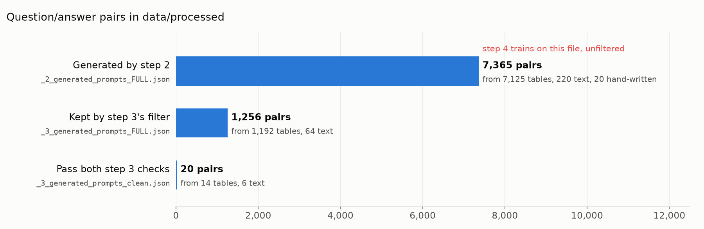

# Chatbot financiero en español: datos de entrenamiento a partir de PDF bancarios

**[In English](README.md)**

Cinco documentos de un banco español (Caja de Ingenieros: tarifas de transferencias al
extranjero, la ficha técnica de un fondo, el catálogo de préstamos y dos notas sobre el fondo
CI Environment ISR, 43 páginas en total) se convierten en **pares de pregunta y respuesta en
español**, y con ellos se ajustan dos modelos de lenguaje, BLOOM-560m y Llama-2-7B. El objetivo
era un chatbot que respondiera preguntas como *"¿Qué requisitos hay que cumplir para solicitar
un préstamo postgrado?"*. El repositorio llega hasta los scripts de entrenamiento: no tiene
interfaz de chat ni modelo entrenado.

<p align="center">
  
</p>

## El proceso



| Paso | Script en `pipeline/` | Qué hace | ¿Funciona? |
|---|---|---|---|
| 1 | `1_extract_all.py`, `1_extract_w1_fees.py`, `1_extract_w3_catalogue.py` | lee los `.docx` con python-docx: secciones de texto y tablas a JSON | sí, CPU |
| 1b | `1b_join.py` | une los cinco ficheros por documento en `_1_combined.json` | sí |
| 2 | `2_questions_sections.py`, `2_questions_tables.py` | preguntas con plantillas, entidades de spaCy y modelos de generación de preguntas en español | **no**, ver [problemas conocidos](#problemas-conocidos) |
| 3 | `3_validate.py` | puntúa cada par por palabras clave compartidas y similitud de texto | sí, unos 2 min en CPU |
| 4 | `4_train_bloom.py`, `4_train_llama2.py` | ajusta los modelos con los pares del paso 2 | necesita GPU; comprobado en CPU con un BLOOM diminuto |

Lo que genera el paso 2 y lo que opina de ello el paso 3 (gráfico en inglés):

<p align="center">
  
</p>

Dos pares del dataset, uno de una sección de texto y otro de una tabla:

```text
P: Para las transferencias no STP, ¿ qué tipo de comisión requiere una comisión adicional?
R: Para transferencias No STP (“Straight Through Processing”) se percibe una comisión adicional
   de 15€ por falta de BIC/IBAN o por datos incorrectos. Debe informarse al ordenante.

P: ¿Qué detalles están asociados con la ubicación para el elemento 'Target – 2' en la tabla
   'transferencias extrangero TRANSFERENCIAS EMITIDAS'?
R: EUR: EUR | ----: ---- | Nacionales/Internacionales dentro de la UE (…): Nacionales (OMF-España)
   Urgentes mismo día | … | 0 €: 2,5‰ Mín. 10€ Máx. 100€
```

La segunda respuesta empareja cada valor con un valor de la fila SEPA en lugar del nombre de
la columna: es la cabecera que falta en la imagen de arriba. [docs/method_es.md](docs/method_es.md)
es la descripción original de cada paso ([in English](docs/method.md)).

## Ejecutarlo

Probado con Python 3.11:

```bash
pip install -r requirements.txt && pip install -e .     # -e permite importar finchat/ desde pipeline/
python pipeline/1_extract_all.py                         # segundos; data/processed/extracted_word_data.json
python pipeline/3_validate.py                            # ~2 min; reescribe data/processed/_3_*.json
python pipeline/4_train_bloom.py                         # GPU; modelos y logs en outputs/
python tools/check_imports.py                            # lo que ejecuta la CI
```

Los scripts funcionan desde cualquier carpeta: `finchat/paths.py` encuentra `data/` y
`outputs/` a partir de la raíz del repositorio. Sobre el `_2_generated_prompts_FULL.json`
actual, el paso 3 conserva 1.274 pares y da 25 válidos, no los 1.256 y 20 de los ficheros
guardados: estos se hicieron antes de añadir los 20 pares escritos a mano.

## Estructura

```
pipeline/         los pasos, en orden: 1_extract_*, 1b_join, 2_questions_*, 3_validate, 4_train_*
finchat/          lo que comparten: paths.py, questions.py (plantillas y modelos de preguntas),
                  validation.py (si una respuesta corresponde a su pregunta)
data/raw/         los cinco documentos: cada PDF y el .docx hecho a partir de él con iLovePDF
data/processed/   el dataset: el JSON de los pasos 1 a 3, como en el gráfico
docs/             method.md y method_es.md (la descripción original), img/
tools/            check_imports.py (CI), make_readme_figures.py (estas imágenes)
legacy/           un módulo auxiliar que nadie importa y dos JSON sustituidos
outputs/          modelos, checkpoints y logs del paso 4 (fuera de git)
```

## Problemas conocidos

- **El paso 2 no puede ejecutarse.** Importa `generate_questions_by_Model` de
  `finchat/google_generate_ask.py`, un módulo que nunca se subió al repositorio.
- **El dataset no se puede reconstruir con los scripts.** Las entradas de la unión,
  `_1_w1.json` a `_1_w5.json`, se editaron después del paso 1: para W3, el paso 1 encuentra 65
  secciones y 38 tablas y `_1_w3.json` tiene 6 y 91; W2, W4 y W5 contienen más de lo que extrae
  el paso 1. `_1_combined.json` también se editó (la unión da 119 tablas, el fichero tiene 117).
  La referencia es `data/processed/`.
- **Las tablas de tarifas de W1 pierden los nombres de las columnas** en el paso 1, y sus
  respuestas quedan como el segundo ejemplo de arriba.
- **El entrenamiento usa los pares sin filtrar.** Los dos scripts del paso 4 leen la salida del
  paso 2; nadie lee la del paso 3.
- **Las etiquetas no enseñan al modelo a responder.** Los dos modelos son causales (solo
  decodificador), pero los scripts dan la pregunta como entrada y los tokens de la respuesta
  como etiquetas, posición a posición y con el relleno incluido. En un modelo causal la entrada
  debe ser pregunta y respuesta en una sola secuencia, con las etiquetas enmascaradas (-100) en
  la pregunta y en el relleno.
- **Las preguntas de evaluación están en los datos de entrenamiento.** Los 20 primeros pares de
  `_2_generated_prompts_FULL.json` son respuestas escritas a mano a las 10 preguntas que
  `4_train_bloom.py` hace en cada checkpoint, y BLOOM se evalúa con su propio conjunto de
  entrenamiento.
- **Llama-2-7B se ajusta entero** en fp16. Eso necesita bastante más de 100 GB de memoria de
  GPU; LoRA o QLoRA (la librería `peft`) caben en una sola GPU. El modelo es de acceso
  restringido: antes hay que aceptar la licencia de Meta en Hugging Face.
- Los documentos son de Caja de Ingenieros. Conviene comprobar que se pueden republicar aquí.

Para cinco documentos cuyas comisiones y tipos cambian, la recuperación (buscar en las secciones
y tablas extraídas y que un modelo de instrucciones responda con lo encontrado, citando la
fuente) probablemente funcionaría mejor que el ajuste fino, y no necesita reentrenar cuando
cambia un documento.

## Qué cambia en esta reorganización

- Los scripts pasan a `pipeline/` con nombres en orden de ejecución, el código compartido al
  paquete `finchat/`, los documentos y el JSON a `data/`, los README antiguos a `docs/` y lo que
  no se usa a `legacy/`. Todo se movió con `git mv`, así que `git log --follow` sigue mostrando
  la historia de cada fichero.
- Las rutas ya no dependen de la carpeta desde la que se ejecuta.
- `requirements.txt` pedía `docx==0.2.4` (otro paquete, de Python 2; el código necesita
  `python-docx`) y `transformers==4.18.0`, anterior a Llama 2. Ahora lista lo que el código
  importa, incluido el modelo de spaCy en español.
- Paso 4: `evaluation_strategy` (eliminado del transformers actual) pasa a `eval_strategy`;
  `4_train_bloom.py` llamaba dos veces a `trainer.train()`, así que entrenaba 6 épocas y no 3;
  el modelo de Llama pasa a `meta-llama/Llama-2-7b-hf`, el que Transformers puede cargar.
- Una comprobación en la CI de que todos los imports de `finchat` existen.
